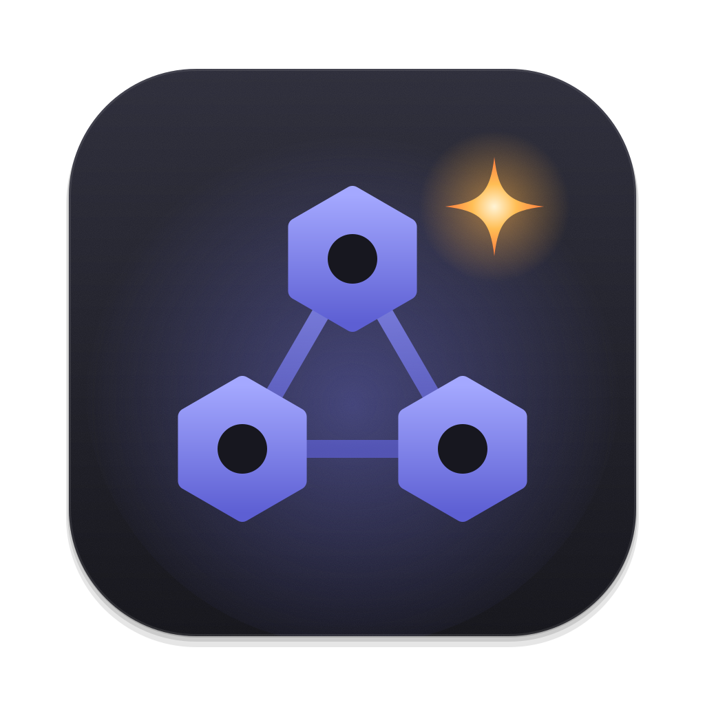
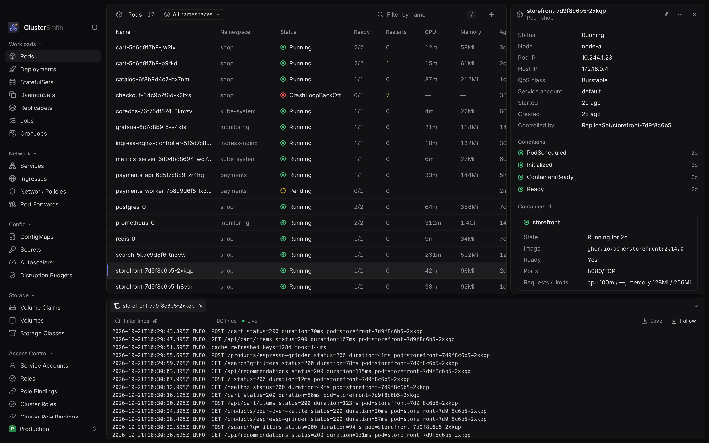

<p align="center">
  
</p>

<h1 align="center">ClusterSmith</h1>

<p align="center">
  A fast, focused Kubernetes desktop client built with Tauri, Rust and React.
</p>



ClusterSmith is a lightweight alternative to Lens for everyday cluster work.
It is early and in development, and so far tested on macOS only.

## Install

```bash
brew install --cask twan-nguyen/tap/clustersmith
```

## Development

You need Rust, Node.js and pnpm.

```bash
pnpm install
pnpm tauri dev
```

## License

[MIT](LICENSE)
